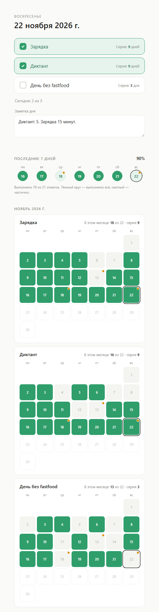

# Ежедневный трекер привычек

Личный ежедневный планер для трёх привычек: **зарядка**, **диктант**, **день без fastfood**. Это один файл `index.html` без сервера и внешних зависимостей: откройте его в браузере. Отметки и заметки хранятся локально в localStorage браузера.

## Первый промпт-ТЗ

> [Создай инструмент внутри папки tools2/habit-tracker.
>
> Задача — сделать личный ежедневный планер (трекер привычек), где я каждый день отмечаю выполнение трех дел: «Зарядка», «Диктант», «День без fastfood».
> Контекст — пользоваться буду только я на своем компьютере. Важно, чтобы мои отметки сохранялись локально (в файле или в памяти браузера) и не пропадали после закрытия или обновления страницы. Внешние платные API не нужны.
> Формат — локальный сайт (HTML/веб-интерфейс), который легко открывается в браузере. На экране сегодняшняя дата и три понятные кнопки/чекбокса для отметок.
> Пример — минималистичный и чистый трекер привычек.
> Готово, когда — открывается в браузере, я могу поставить галочки на сегодня, обновить страницу, и галочки остаются на месте.
> Сначала задай мне 3 уточняющих вопроса, потом делай.]

## Финальные улучшения (что было доработано)

> [Улучшение 1:
> Что не так — сейчас я вижу отметки только за сегодняшний день, но не вижу общей картины прогресса и сколько дней подряд я не срываюсь.
> Как должно быть — добавь сетку-календарь на текущий месяц по каждой из трех привычек и счетчик «серии дней подряд» (streak) для зарядки, диктанта и дней без fastfood, плюс общий процент выполнения за неделю.
> Зачем — чтобы визуально видеть свой прогресс и была мотивация не прерывать цепочку.
>
> Улучшение 2:
> Что не так — если я забыла зайти в планер вечером, на следующий день я не могу отметить вчерашний день, и некуда записать детали (например, как прошел диктант).
> Как должно быть — сделай так, чтобы можно было кликнуть на любой прошлый день в календаре и поставить/снять галочки, а также добавь к каждому дню короткое текстовое поле «Заметка дня» (например, для оценки за диктант или причины пропуска).
> Зачем — чтобы статистика не ломалась, если я заполняю планер утром, и чтобы можно было отслеживать качество диктантов.]

## Скриншот

## Какое указание сильнее всего изменило инструмент

Сильнее всего инструмент изменило второе уточняющее указание про календарь на месяц, счетчик серий (streak) и возможность отмечать прошлые дни с заметками. После него планер перестал быть просто тремя одноразовыми галочками на экране и превратился в реальный рабочий дневник прогресса.
